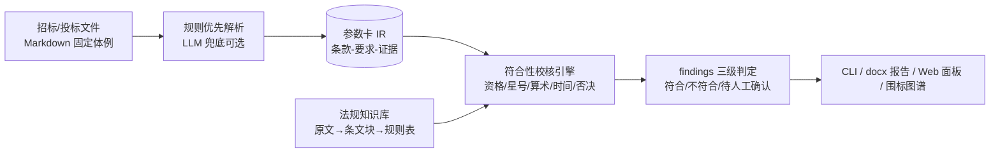

# bidding-document-checker

招投标文件智能评审与合规校核系统（公共采购）——面向招标/投标文件的双侧自动解析、
资格与实质性条款符合性校核、法规依据关联与评审报告生成。

> 🚧 **状态：M2 解析层**——计划文档、合成数据生成器与双侧解析器就绪（解析基准 F1=1.0），功能按里程碑交付（见[路线图](#路线图)）。

## 定位（重要）

- **辅助评审定位，非评标决策工具**：数值类结论全部来自确定性规则并可溯源至法规/招标文件条款；
- 结论三级判定：**符合 / 不符合（风险分级）/ 待人工确认**，多值与低置信度不硬判；
- 所有演示数据为程序合成（虚构主体），不含任何真实主体信息；不含授标/报价建议。

## 特性（按里程碑交付）

- 双侧解析：招标文件 → 采购需求参数卡；投标文件 → 投标响应参数卡（统一中间表示，字段带证据）；
- 符合性校核：资格比对 / 星号条款核验 / 算术复核（大小写金额、分项合计）/ 时间逻辑 / 否决项扫描；
- 法规知识库：原文 → 条文块 → 机器可读规则表，每条结论挂依据；
- 围标串标文本特征图谱（加分项）：相似度 + 异常一致性，0 外链可视化 HTML；
- 交付形态：CLI / docx 评审报告 / Web 面板（免构建、断网可演示）；
- 内置评测基准：零 API 依赖可重复，指标达标后写入本 README。

## 快速开始（开发模式）

```bash
py -m venv .venv
source .venv/Scripts/activate   # Windows Git Bash；Linux/macOS: source .venv/bin/activate
pip install -U pip              # Python 3.8 自带老 pip 无法可编辑安装 pyproject-only 项目
pip install -e ".[dev]"
pytest -q
bidchecker --version
# 生成合成演示数据（固定 seed 位级可复现，含真值与缺陷注入）：
bidchecker datagen --seed 42        # → examples/ 下 3 个演示项目（货物×2、服务×1）
# 解析基准（字段级 P/R/F1，多 seed 对账生成器真值，零 API）：
bidchecker bench parse
```

## CLI

| 命令 | 说明 | 状态 |
|---|---|---|
| `bidchecker --version` | 版本 | ✅ |
| `bidchecker run <项目目录>` | 端到端评审流水线 | 🚧 M3 起 |
| `bidchecker datagen [--seed N] [--out D]` | 合成数据生成器：3 个演示项目（招标 6 章/投标 7 章 Markdown + ground_truth.json，D1–D12 缺陷注入 + 干净对照） | ✅ |
| `bidchecker bench parse [--seed N] [--threshold X]` | 解析基准：字段级 P/R/F1（默认 seeds 1/7/42/123/2026，门槛 F1 ≥ 0.95） | ✅ |
| `bidchecker bench e2e` | 端到端校核基准（检出率/误报率/判定准确率） | 🚧 M4 |
| `bidchecker report` | docx 评审报告 | 🚧 M5 |
| `bidchecker serve` | Web 面板 | 🚧 M5 |

## 架构



详细设计见 [plan/03-架构与技术选型.md](plan/03-架构与技术选型.md)、[plan/04-模块详设.md](plan/04-模块详设.md)。

## 路线图

| 里程碑 | 内容 | 状态 |
|---|---|---|
| M0 | 计划文档 + 工程骨架 + CI | ✅ 2026-10-05 |
| M1 | 数据先行：生成器 + 缺陷注入 + 真值 | ✅ 2026-10-05 |
| M2 | 解析层：双侧参数卡 + 解析 F1 基准 | ✅ 2026-10-05 |
| M3 | 知识与规则：三层知识库 + 符合性引擎 | ⬜ |
| M4 | LLM 兜底 + 端到端基准达标 | ⬜ |
| M5 | CLI 全家桶 + docx 报告 + 围标图谱 + Web | ⬜ |
| M6 | 脱敏发布 GitHub + 收尾固化 | ⬜ |

详见 [plan/05-数据计划与里程碑.md](plan/05-数据计划与里程碑.md)。

## 限制

- v1 标准输入为生成器产出的 Markdown 固定体例（体例即接口）；真实 docx/PDF 适配为缓议加分项；
- 围标分析仅限文本特征，不做主体关系推断，输出为辅助提示而非定性结论；
- LLM 通路默认关闭（环境变量配置），全部功能在无 LLM 环境可跑通。

## 免责声明

本工具输出仅为**辅助评审定位**，不构成评标结论、法律意见或授标建议；最终评审与决策应由
依法组建的评标委员会作出。使用者应自行核验结论与法规依据的适用性。

## License

[MIT](LICENSE)
