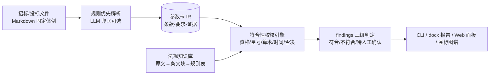

# bidding-document-checker

招投标文件智能评审与合规校核系统（公共采购）——面向招标/投标文件的双侧自动解析、
资格与实质性条款符合性校核、法规依据关联与评审报告生成。

> 🚧 **状态：M5 编排与交付**——计划文档、合成数据生成器、双侧解析器（F1=1.0）、法规知识库、符合性引擎（`bidchecker run` 出带依据的 findings）、围标对文本特征检出与端到端基准达标、docx 评审报告 / 围标图谱 HTML / Web 面板（断网可演示），功能按里程碑交付（见[路线图](#路线图)）。

## 定位（重要）

- **辅助评审定位，非评标决策工具**：数值类结论全部来自确定性规则并可溯源至法规/招标文件条款；
- 结论三级判定：**符合 / 不符合（风险分级）/ 待人工确认**，多值与低置信度不硬判；
- 围标分析仅文本特征（同分钟编制时间戳 + 对照独有共享长句，双信号交叉验证），
  输出"待人工确认"辅助提示，**不出"围标"定性结论**；
- 所有演示数据为程序合成（虚构主体），不含任何真实主体信息；不含授标/报价建议。

## 特性（按里程碑交付）

- 双侧解析：招标文件 → 采购需求参数卡；投标文件 → 投标响应参数卡（统一中间表示，字段带证据）；
- 符合性校核：资格比对 / 星号条款核验 / 算术复核（大小写金额、分项合计）/ 时间逻辑 / 否决项扫描；
- 法规知识库：原文 → 条文块 → 机器可读规则表，每条结论挂依据；
- 围标串标文本特征（M4）：按对检出 同分钟编制时间戳 + 对照独有共享长句 双信号，
  出"待人工确认"提示（挂实施条例 39/40 条 + 87号令 36/37 条）；图谱 HTML（M5）：
  字符 5-gram shingle + Jaccard 两两矩阵 + SVG 力导向布局，点击节点/边展开证据与行号锚点；
- docx 评审报告（M5，`report` extra）：结论汇总 + 分级明细 + 依据/证据锚点（法规条文
  原文与招标条款原文）+ 符合性矩阵（符合项由报告层推导、`--all` 展开）；报告无外链、无时间戳；
- Web 面板（M5，`web` extra）：FastAPI + 零依赖内联单页，上传评审或一键加载内置演示，
  围标图谱交互同款；**0 外链、断网可演示**（LLM 兜底固定禁用）；
- LLM 兜底（M4，可选通路）：仅对规则抽取失败的"宁缺"槽位补抽，quote ⊂ 原文硬校验 +
  数值合法性校验才入卡；**LLM 不产生/不改变任何结论判定**；不可达自动降级纯规则通路；
- 知识库检索（M4）：纯 Python TF 余弦 top_k（不引向量库），供报告层与兜底通路引用；
- 交付形态：CLI / docx 评审报告 / Web 面板 / 围标图谱 HTML；
- 内置评测基准：零 API 依赖可重复，指标见下节。

## 快速开始（开发模式）

```bash
py -m venv .venv
source .venv/Scripts/activate   # Windows Git Bash；Linux/macOS: source .venv/bin/activate
pip install -U pip              # Python 3.8 自带老 pip 无法可编辑安装 pyproject-only 项目
pip install -e ".[dev,report,web,llm]"   # report=docx 报告，web=Web 面板；llm 的 httpx 供 fastapi TestClient（pytest 全量）
pytest -q
bidchecker --version
# 生成合成演示数据（固定 seed 位级可复现，含真值与缺陷注入）：
bidchecker datagen --seed 42        # → examples/ 下 3 个演示项目（货物×2、服务×1）
# 解析基准（字段级 P/R/F1，多 seed 对账生成器真值，零 API）：
bidchecker bench parse
# 端到端基准（检出率/误报/判定准确率，对账真值全集合含 D11 围标对，零 API）：
bidchecker bench e2e
# 端到端评审（演示项目：findings 带法规/条款依据，干净对照零误报；--graph 附带围标图谱）：
bidchecker run examples/demo-goods-1 --out output --graph   # → findings.json + cards/ + collusion_graph.html
bidchecker run examples/demo-goods-2 --out output           # 干净对照组：结论 0 条
# docx 评审报告（依据锚点 + 符合性矩阵；--all 展开符合项明细）：
bidchecker report output/findings.json --all
# Web 面板（浏览器打开 http://127.0.0.1:8000，可一键加载内置演示）：
bidchecker serve --port 8000
```

## CLI

| 命令 | 说明 | 状态 |
|---|---|---|
| `bidchecker --version` | 版本 | ✅ |
| `bidchecker run <项目目录> [--out D] [--graph]` | 端到端评审流水线：解析 → 确定性校核 → findings.json + 参数卡（+ 围标图谱 HTML，退出码 0/1/2） | ✅ |
| `bidchecker datagen [--seed N] [--out D]` | 合成数据生成器：3 个演示项目（招标 6 章/投标 7 章 Markdown + ground_truth.json，D1–D12 缺陷注入 + 干净对照） | ✅ |
| `bidchecker bench parse [--seed N] [--threshold X]` | 解析基准：字段级 P/R/F1（默认 seeds 1/7/42/123/2026，门槛 F1 ≥ 0.95） | ✅ |
| `bidchecker bench e2e [--seed N]` | 端到端基准：检出率（分缺陷类型）/误报数/判定准确率，对账真值全集合含 D11（退出码 0/1） | ✅ |
| `bidchecker report <findings.json> [--out F] [--project D] [--all]` | docx 评审报告：结论汇总 + 分级明细 + 依据/证据锚点 + 符合性矩阵（退出码 0/2；需 `report` extra） | ✅ |
| `bidchecker serve [--host H] [--port P]` | Web 面板：上传评审 / 内置演示一键加载，0 外链断网可演示（需 `web` extra） | ✅ |

## 架构



详细设计见 [plan/03-架构与技术选型.md](plan/03-架构与技术选型.md)、[plan/04-模块详设.md](plan/04-模块详设.md)。

## 路线图

| 里程碑 | 内容 | 状态 |
|---|---|---|
| M0 | 计划文档 + 工程骨架 + CI | ✅ 2026-10-05 |
| M1 | 数据先行：生成器 + 缺陷注入 + 真值 | ✅ 2026-10-05 |
| M2 | 解析层：双侧参数卡 + 解析 F1 基准 | ✅ 2026-10-05 |
| M3 | 知识与规则：三层知识库 + 符合性引擎 + run 端到端 | ✅ 2026-10-05 |
| M4 | LLM 兜底 + 端到端基准达标 | ✅ 2026-10-05 |
| M5 | CLI 全家桶 + docx 报告 + 围标图谱 + Web | ✅ 2026-10-05 |
| M6 | 脱敏发布 GitHub + 收尾固化 | ⬜ |

详见 [plan/05-数据计划与里程碑.md](plan/05-数据计划与里程碑.md)。

## 内置基准指标（固定 seed 可重复，零 API 依赖）

| 基准 | 指标 | 数值 | 命令 |
|---|---|---|---|
| bench parse | 字段级 F1（5 seeds × 3 项目 × 65 文档微平均） | **1.0**（门槛 ≥ 0.95） | `bidchecker bench parse` |
| bench e2e | 检出率（分缺陷类型 D1–D12，含隐含结论全集合） | **1.0**（门槛 ≥ 0.95） | `bidchecker bench e2e` |
| bench e2e | 误报数（干净对照 + 非目标文档） | **0** | `bidchecker bench e2e` |
| bench e2e | 判定准确率（四元组微平均 tp/(tp+fp+fn)） | **1.0** | `bidchecker bench e2e` |

对账口径：e2e 按 ground_truth.json 全集合（expect_findings + also_expect，**含 D11 围标对**）
的四元组 (rule_type, status, risk_level, target) 与 findings 逐条比对；默认 seeds
1/7/42/123/2026，全部项目全集合一致。LLM 兜底在基准中固定禁用（纯规则通路）。

## 限制

- v1 标准输入为生成器产出的 Markdown 固定体例（体例即接口）；真实 docx/PDF 适配为缓议加分项；
- 围标分析仅限文本特征，不做主体关系推断，输出为辅助提示而非定性结论；
- LLM 通路默认关闭（环境变量配置），全部功能在无 LLM 环境可跑通。

## 免责声明

本工具输出仅为**辅助评审定位**，不构成评标结论、法律意见或授标建议；最终评审与决策应由
依法组建的评标委员会作出。使用者应自行核验结论与法规依据的适用性。

## License

[MIT](LICENSE)
